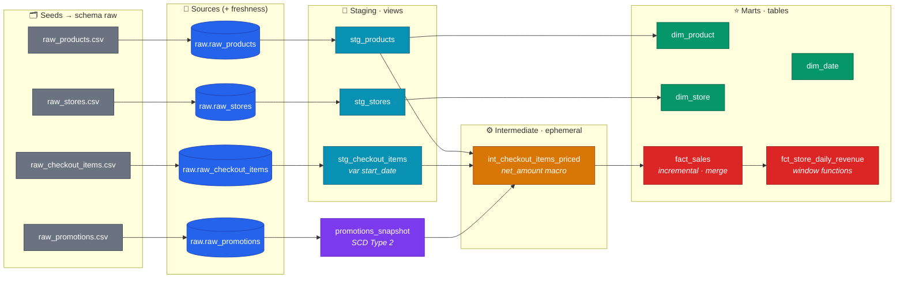
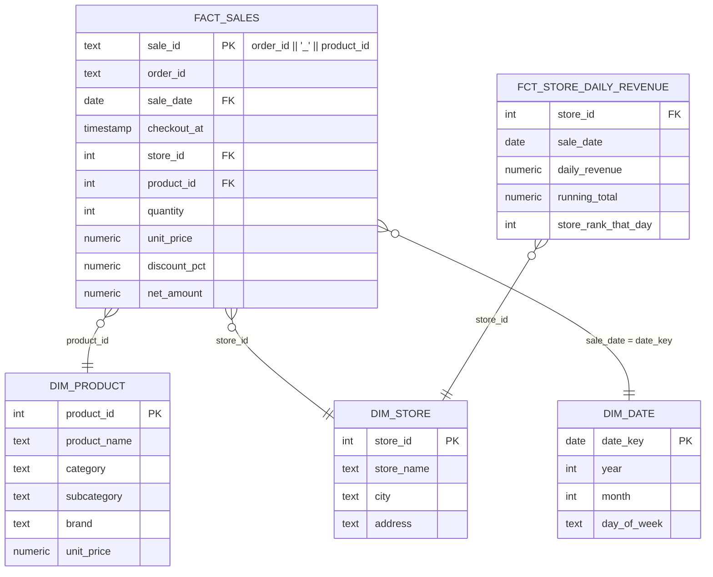
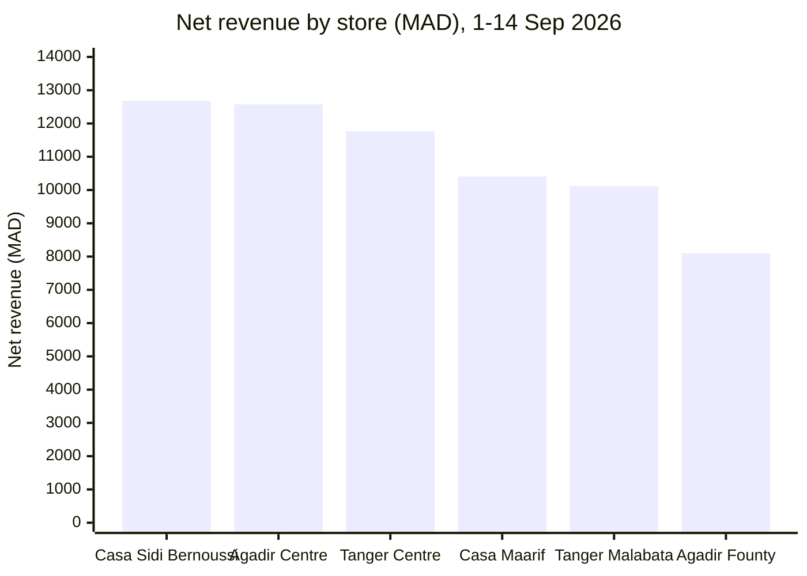

<div align="center">

# 🛒 BIM Retail Analytics: dbt + PostgreSQL

**An end-to-end analytics engineering project that turns raw retail checkout data into a tested, documented star schema with dbt.**

[](https://github.com/Aeljirai/dbt-postgres-retail-sales-analytics/actions/workflows/dbt-ci.yml)


</div>

---

## 📌 Overview

**BIM** is a discount grocery chain with stores in Casablanca, Tanger and Agadir. Its raw data is four flat files: products, stores, promotions and checkout line items. On their own they don't answer basic business questions like *"Which store earned the most yesterday?"* or *"How much revenue did promotions cost us?"*

This project builds the warehouse layer that answers them. It uses **dbt on PostgreSQL** and follows the conventions of a production analytics engineering codebase: layered models, a dimensional (Kimball) star schema, incremental loads, SCD Type 2 history, reusable macros, and automated data quality tests that run in **CI on every push**.

| | |
|---|---|
| **Domain** | Retail / grocery sales (Morocco) |
| **Stack** | dbt Core · PostgreSQL 16 · Docker Compose · GitHub Actions · Adminer |
| **Data** | 25 products · 6 stores · 8 promotions · 772 checkout line items (303 orders) |
| **Output** | Star schema (3 dimensions + 1 fact) + a daily revenue mart built with window functions |
| **Quality** | 16 data tests (generic + singular) and source freshness checks |

---

## 🧭 Data lineage (DAG)



## ⭐ Star schema



---

## 📊 What the model answers

Net revenue by store over 1–14 September 2026, after promotions are applied (total ≈ **65,645 MAD**). These figures come from the `fact_sales` mart.



Example questions the marts answer in a single query:

```sql
-- Which store led each day, and what is its cumulative revenue?
select store_id, sale_date, daily_revenue, running_total
from dbt_dev.fct_store_daily_revenue
where store_rank_that_day = 1
order by sale_date;

-- Revenue by product category and city
select p.category, s.city, sum(f.net_amount) as revenue
from dbt_dev.fact_sales f
join dbt_dev.dim_product p using (product_id)
join dbt_dev.dim_store   s using (store_id)
group by 1, 2
order by revenue desc;
```

---

## 🧠 dbt skills demonstrated

| Concept | Where | Why it matters |
|---|---|---|
| **Layered architecture** (staging → intermediate → marts) | [`models/`](dbt_project/models) | Each layer has one job: clean, then combine, then serve |
| **Seeds** with explicit column types | [`seeds/schema.yml`](dbt_project/seeds/schema.yml) | Reproducible raw layer, no hidden type inference |
| **Sources + freshness SLAs** (warn 24h / error 48h) | [`sources.yml`](dbt_project/models/staging/sources.yml) | Catches stale upstream loads before they reach dashboards |
| **Incremental model** (`merge`, `unique_key`) | [`fact_sales.sql`](dbt_project/models/marts/fact_sales.sql) | Processes only new checkouts instead of rebuilding the full table |
| **Snapshot: SCD Type 2** (`check` strategy) | [`promotions_snapshot.sql`](dbt_project/snapshots/promotions_snapshot.sql) | Keeps the full history of promotion changes with `dbt_valid_from/to` |
| **Ephemeral model** | [`int_checkout_items_priced.sql`](dbt_project/models/intermediate/int_checkout_items_priced.sql) | Business logic is reused as a CTE with no extra warehouse object |
| **Custom macro** | [`net_amount.sql`](dbt_project/macros/net_amount.sql) | One place defines the pricing formula, so it can't drift between models |
| **`generate_schema_name` override** | [`generate_schema_name.sql`](dbt_project/macros/generate_schema_name.sql) | Clean schema names (`raw`, `snapshots`, `dbt_dev`) |
| **Project variables** (`var('start_date')`) | [`stg_checkout_items.sql`](dbt_project/models/staging/stg_checkout_items.sql) | Run-time parameters without editing SQL |
| **Window functions** (running total, daily rank) | [`fct_store_daily_revenue.sql`](dbt_project/models/marts/fct_store_daily_revenue.sql) | Analytics-ready metrics computed in the warehouse |
| **Generic tests** (`unique`, `not_null`, `accepted_values`, `relationships`) | [`schema.yml`](dbt_project/models/marts/schema.yml) | Primary keys and referential integrity are enforced on every run |
| **Singular test** | [`assert_net_amount_not_above_list_price.sql`](dbt_project/tests/assert_net_amount_not_above_list_price.sql) | Encodes a business rule: a discount can never raise a price |
| **CI/CD** with a Postgres service container | [`.github/workflows/dbt-ci.yml`](.github/workflows/dbt-ci.yml) | Every push runs `dbt build` against a fresh warehouse |

### Design decisions

- **`LEFT JOIN` on purpose in the intermediate layer.** A checkout row that points to an unknown product is *not* silently dropped. It flows into `fact_sales`, where the `relationships` test fails loudly. Tests are the quality gate; joins don't hide bad data.
- **Fact grain is explicit:** one row = one product line within one checkout. The surrogate key is `order_id || '_' || product_id`.
- **The incremental trade-off is documented.** If a promotion changes, rows that were already loaded keep the old price until a `--full-refresh`. This is demonstrated step by step below.
- **Self-contained.** No external packages (`dbt deps` isn't needed). The date dimension uses Postgres `generate_series` instead of `dbt_utils.date_spine`.

---

## 📁 Project structure

```
.
├── docker-compose.yml               # Postgres 16 warehouse + Adminer UI
├── .github/workflows/dbt-ci.yml     # CI: dbt build on every push / PR
└── dbt_project/
    ├── dbt_project.yml              # materializations per layer, vars
    ├── profiles.yml.example         # connection profile (copy to ~/.dbt/)
    ├── seeds/                       # raw CSVs + column types
    ├── models/
    │   ├── staging/                 # stg_* views, sources.yml, tests
    │   ├── intermediate/            # ephemeral pricing logic
    │   └── marts/                   # dim_*, fact_sales, fct_store_daily_revenue
    ├── snapshots/                   # promotions_snapshot (SCD 2)
    ├── macros/                      # net_amount, generate_schema_name
    └── tests/                       # singular business-rule tests
```

---

## 🚀 Quick start

**Prerequisites:** Docker Desktop, Python 3.9+, a Bash shell. Ports `5432` (Postgres) and `8082` (Adminer) must be free.

```bash
git clone https://github.com/Aeljirai/dbt-postgres-retail-sales-analytics.git
cd dbt-postgres-retail-sales-analytics

docker compose up -d                          # empty Postgres: bim_warehouse (user bim / password bim)

python -m venv .venv
source .venv/bin/activate                     # Git Bash on Windows: source .venv/Scripts/activate
pip install dbt-postgres

mkdir -p ~/.dbt                               # Windows: %USERPROFILE%\.dbt
cp dbt_project/profiles.yml.example ~/.dbt/profiles.yml

cd dbt_project
dbt debug                                     # expect: All checks passed!
dbt build                                     # seed → snapshot → run → test, in DAG order
```

Expected result: **29 nodes, all green** (4 seeds, 1 snapshot, 8 models, 16 tests).

Browse the warehouse in Adminer at http://localhost:8082. Use System `PostgreSQL`, Server `postgres`, user `bim`, password `bim`, database `bim_warehouse`.

| Schema | Contents |
|---|---|
| `raw` | Seeded raw tables |
| `snapshots` | `promotions_snapshot` (SCD 2) |
| `dbt_dev` | Staging views and mart tables |

---

## 🔬 Step-by-step walkthrough

<details>
<summary><b>1. Load raw data with <code>dbt seed</code></b></summary>

```bash
dbt seed
```

This creates 4 tables in schema `raw`: products (25), stores (6), promotions (8), checkout items (772). Column types are set in `seeds/schema.yml`, and the schema in `dbt_project.yml` (`+schema: raw`).

> Seeds suit small, static files. In production, raw data is loaded by Fivetran, Airbyte or Airflow, and `sources.yml` stays exactly the same.
</details>

<details>
<summary><b>2. Staging and project variables</b></summary>

```bash
dbt run --select staging
dbt run --select staging --vars '{"start_date": "2026-09-05"}'    # override the variable
dbt run --select staging                                          # back to the default
```

`stg_checkout_items` filters on `var('start_date')`. The default is set in `dbt_project.yml`.
</details>

<details>
<summary><b>3. Source freshness</b></summary>

```bash
dbt source freshness
```

Expected: **ERROR**. The newest checkout is from September 2026, so the data counts as stale, which shows the check is working. To see a PASS, raise the thresholds in `sources.yml` (for example `warn_after: {count: 50000, period: hour}`), then restore them.
</details>

<details>
<summary><b>4. Snapshot, marts and tests</b></summary>

```bash
dbt snapshot                       # promotions_snapshot: 8 rows (schema "snapshots")
dbt run --select marts
dbt test                           # 16 tests, all PASS
```
</details>

<details>
<summary><b>5. Watch a data test catch bad data</b></summary>

```bash
docker compose exec postgres psql -U bim -d bim_warehouse -c \
  "INSERT INTO raw.raw_checkout_items VALUES ('ord_test_bad', 1, 999, 1, now());"
dbt run --select fact_sales --full-refresh
dbt test --select fact_sales        # FAIL 1: relationships_fact_sales_product_id...

# clean up
docker compose exec postgres psql -U bim -d bim_warehouse -c \
  "DELETE FROM raw.raw_checkout_items WHERE order_id = 'ord_test_bad';"
dbt run --select fact_sales --full-refresh && dbt test
```

Product `999` doesn't exist. The `LEFT JOIN` lets the row through and the `relationships` test catches it.
</details>

<details>
<summary><b>6. Incremental gotcha and SCD Type 2 in action</b></summary>

```bash
docker compose exec postgres psql -U bim -d bim_warehouse -c \
  "UPDATE raw.raw_promotions SET discount_pct = 25 WHERE promo_id = 1;"
dbt snapshot
dbt run --select fact_sales
docker compose exec postgres psql -U bim -d bim_warehouse -c \
  "SELECT discount_pct, count(*) FROM dbt_dev.fact_sales WHERE product_id = 2 GROUP BY 1;"
```

Old rows **keep 10%**, because `is_incremental()` only reads new `checkout_at` values. The fix costs a full rebuild:

```bash
dbt run --select fact_sales --full-refresh      # now every row shows 25%
docker compose exec postgres psql -U bim -d bim_warehouse -c \
  "SELECT promo_id, discount_pct, dbt_valid_from, dbt_valid_to FROM snapshots.promotions_snapshot WHERE promo_id = 1;"
```

The snapshot now holds **2 versions** of promo 1: the old one is closed (`dbt_valid_to` is set) and the new one is open. None of this history logic was written by hand; `strategy='check'` handles it.

To reset: `dbt seed`, then `dbt snapshot`, then `dbt run --full-refresh`.
</details>

<details>
<summary><b>7. Window functions</b></summary>

```bash
docker compose exec postgres psql -U bim -d bim_warehouse -c \
  "SELECT * FROM dbt_dev.fct_store_daily_revenue ORDER BY store_id, sale_date LIMIT 15;"
```

`running_total` is partitioned by store and `store_rank_that_day` by day. The GROUP BY collapses to store × day first, and the windows then add columns without collapsing rows.
</details>

<details>
<summary><b>8. Docs and interactive lineage</b></summary>

```bash
dbt docs generate
dbt docs serve                  # http://localhost:8080
```
</details>

```bash
docker compose down -v          # stop and delete all data
```

---

## 🛠️ Troubleshooting

| Symptom | Fix |
|---|---|
| `port is already allocated` (5432) | Stop the other Postgres, or change the port in both `docker-compose.yml` and `~/.dbt/profiles.yml` |
| `dbt debug` connection refused | Run `docker compose ps` and wait a few seconds after `up -d` |
| `Could not find profile named 'bim_analytics'` | Copy the profile to `~/.dbt/profiles.yml` and run dbt from `dbt_project/` |
| `relation "raw.raw_..." does not exist` | Run `dbt seed` first |
| `relation "snapshots.promotions_snapshot" does not exist` | Run `dbt snapshot` before `dbt run --select marts` |
| `accepted_values` syntax error | The project uses the `arguments:` form (dbt 1.10+): `pip install -U dbt-postgres` |
| `dbt docs serve` port busy | `dbt docs serve --port 8081` |
| Adminer login fails | Server must be `postgres`, not `localhost` |

---

## 🗺️ Possible extensions

- Point-in-time pricing: join each sale to the promotion version valid at `checkout_at` (`dbt_valid_from <= checkout_at < dbt_valid_to`)
- `dbt_utils` / `dbt_expectations` for richer tests and a `date_spine`
- Semantic layer metrics (revenue, average basket, promo uplift)
- A BI dashboard (Metabase / Superset) on top of the marts

---

## 👤 Author

**Alaa El Jirari**, Data & Analytics Engineer

[](https://github.com/Aeljirai)

If this project was useful or interesting, a ⭐ is appreciated.
